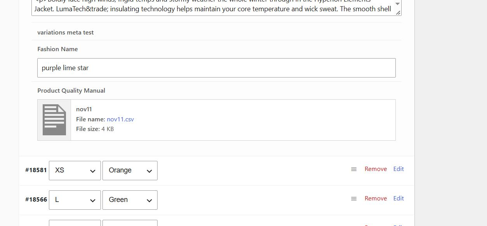

# ACF Variations Enhancer 
Requires: Advanced Custom Fields 5.9+, WooCommerce
Adds location rule "Product Variation == All variations" so any ACF field type
can be attached to WooCommerce variations. Data is stored as normal post meta on
the variation (read with get_field('name', $variation_id)).

Test: wp acfve test --user=admin

## Show variations meta into product details page[before add to cart btn]
```
/**
 * Display ACF variation fields before the Add to Cart button
 * Fields:
 * - fashion_name
 * - product_quality_manual
 * - Note: This is a test code for preview.
 */

/**
 * Add ACF fields to WooCommerce variation data.
 */
add_filter('woocommerce_available_variation', function ($variation_data, $product, $variation) {

    $fashion_name = get_field('fashion_name', $variation->get_id());
    $quality_manual = get_field('product_quality_manual', $variation->get_id());

    $variation_data['acf_fashion_name'] = $fashion_name;
    $variation_data['acf_product_quality_manual'] = $quality_manual;

    return $variation_data;

}, 10, 3);


/**
 * Add the container before the Add to Cart button.
 */
add_action('woocommerce_before_add_to_cart_button', function () {

    if (!is_product()) {
        return;
    }

    ?>
    <div id="variation-acf-info" class="variation-acf-info" style="display:none;">

        <div class="variation-acf-field variation-fashion-name">
            <strong>Fashion Name:</strong>
            <span class="variation-fashion-name-value"></span>
        </div>

        <div class="variation-acf-field variation-quality-manual">
            <strong>Product Quality Manual:</strong>
            <a class="variation-quality-manual-link"
               href="#"
               target="_blank"
               rel="noopener"
               style="display:none;">
                View Product Quality Manual
            </a>
        </div>

    </div>
    <?php

});


/**
 * Update the ACF fields when a variation is selected.
 */
add_action('wp_footer', function () {

    if (!is_product()) {
        return;
    }

    ?>
    <script>
    jQuery(function($) {

        var $form = $('.variations_form');
        var $info = $('#variation-acf-info');

        if (!$form.length || !$info.length) {
            return;
        }

        $form.on('found_variation', function(event, variation) {

            var fashionName = variation.acf_fashion_name || '';
            var qualityManual = variation.acf_product_quality_manual || '';

            var $fashionField = $('.variation-fashion-name');
            var $fashionValue = $('.variation-fashion-name-value');

            var $manualField = $('.variation-quality-manual');
            var $manualLink = $('.variation-quality-manual-link');

            // Reset
            $fashionValue.text('');
            $manualLink.hide().attr('href', '');

            $fashionField.hide();
            $manualField.hide();

            // Fashion Name
            if (fashionName) {
                $fashionValue.text(fashionName);
                $fashionField.show();
            }

            // Product Quality Manual
            if (qualityManual) {

                var manualURL = '';

                // ACF file field returning an array
                if (typeof qualityManual === 'object' && qualityManual.url) {
                    manualURL = qualityManual.url;
                }

                // In case the value is a URL/string
                else if (typeof qualityManual === 'string') {
                    manualURL = qualityManual;
                }

                if (manualURL) {
                    $manualLink
                        .attr('href', manualURL)
                        .show();

                    $manualField.show();
                }
            }

            // Show entire container if at least one field exists
            if (fashionName || qualityManual) {
                $info.show();
            } else {
                $info.hide();
            }

        });

        // Hide when variation selection is reset
        $form.on('reset_data', function() {
            $info.hide();

            $('.variation-fashion-name').hide();
            $('.variation-quality-manual').hide();

            $('.variation-fashion-name-value').text('');
            $('.variation-quality-manual-link')
                .hide()
                .attr('href', '');
        });

    });
    </script>
    <?php

});
```


## Proff Images



