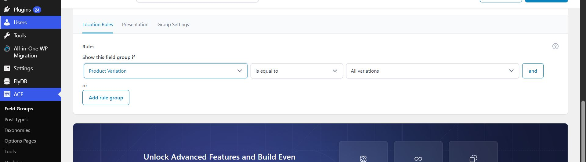
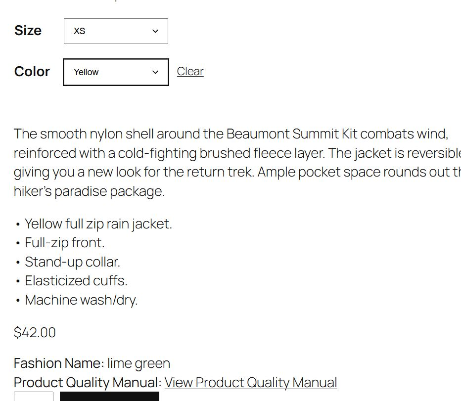

# ACF Variations Enhancer 
Requires: Advanced Custom Fields 5.9+, WooCommerce
Adds location rule "Product Variation == All variations" so any ACF field type
can be attached to WooCommerce variations. Data is stored as normal post meta on
the variation (read with get_field('name', $variation_id)).

Test: wp acfve test --user=admin

## Proff Images

